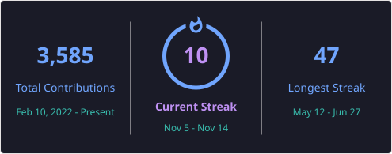

# Hi there, I'm Luoye 👋

  

  It seems you've stumbled upon my little corner of the internet. Welcome!  
  I'm passionate about building decentralized applications, automation tools, and exploring the frontiers of Web3.  

 

---

### 📊 GitHub Stats

 

---

### 🔥 Contribution Streak

---

### 🛠 Tech Stack

  
  

---

### 🐍 GitHub Snake

  

 

### 👁 Profile Views

  

